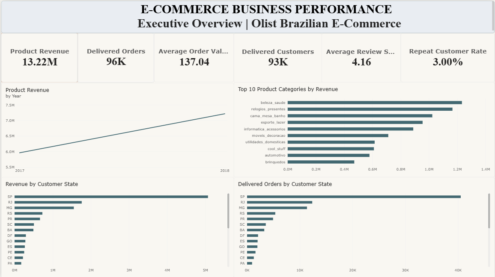
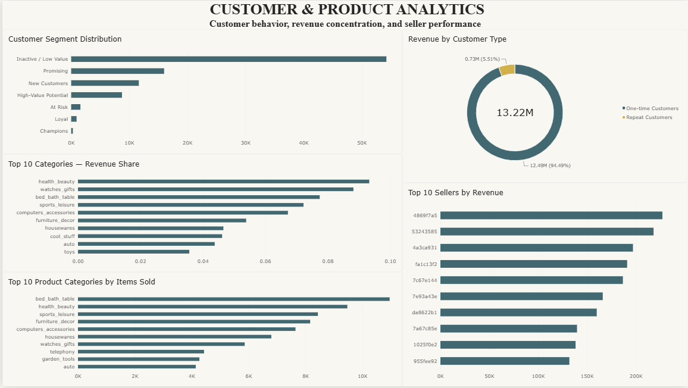
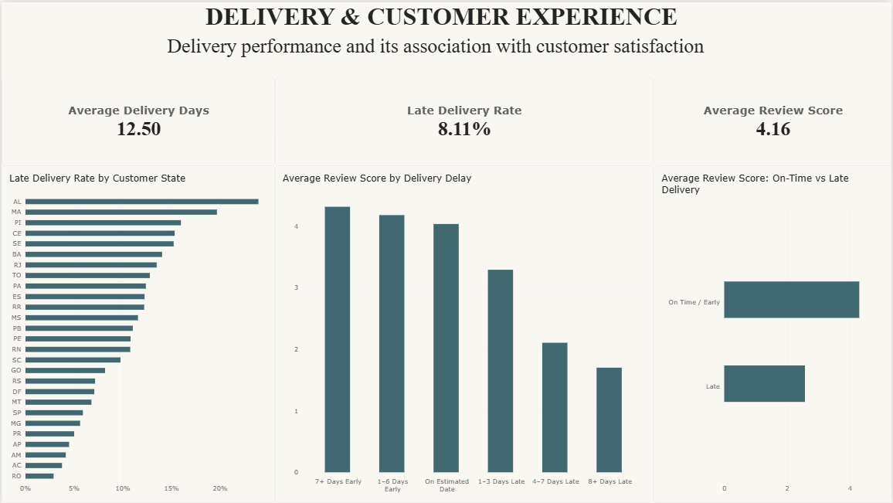

# E-Commerce Business Performance & Customer Analytics

## Project Overview

This project analyzes the **Brazilian E-Commerce Public Dataset by Olist** using **PostgreSQL, SQL, and Power BI** to uncover business performance, customer behavior, product concentration, seller performance, and the relationship between delivery performance and customer satisfaction.

The project was designed as an **end-to-end business analytics portfolio project**: raw multi-table e-commerce data was loaded into PostgreSQL, validated and analyzed with SQL, modeled in Power BI, and transformed into a three-page interactive dashboard for executive, customer/product, and delivery/customer-experience analysis.

---

## Business Objectives

The analysis was built around five practical business questions:

1. **How is the business performing overall?**
2. **Which product categories, customer locations, and sellers drive revenue?**
3. **How strong is customer retention and repeat purchasing?**
4. **How concentrated is revenue across categories and customer groups?**
5. **How is delivery performance associated with customer review scores?**

---

## Tools & Technologies

- **PostgreSQL** — database creation, data storage, joins, data validation, and analysis
- **SQL** — KPI calculation, customer analysis, product/category analysis, seller analysis, delivery analysis
- **Power BI** — data modeling, DAX measures, interactive dashboards, business visualization
- **VS Code** — SQL development and project organization
- **Git / GitHub** — portfolio version control and project documentation

---

## Dataset

The project uses the **Brazilian E-Commerce Public Dataset by Olist**, a multi-table dataset containing approximately **100,000 orders**.

### Main tables used

| Table | Purpose |
|---|---|
| `customers` | Customer identifiers and location |
| `orders` | Order status and timestamps |
| `order_items` | Product, seller, price, and freight data |
| `products` | Product attributes and category |
| `category_translation` | Portuguese-to-English category mapping |
| `sellers` | Seller identifiers and location |
| `reviews` | Review scores and review text |
| `payments` | Payment information |
| `geolocation` | Geographic reference data |

The core analysis focused on **delivered orders** to keep commercial KPIs consistent.

---

## Data Preparation & Quality Checks

Before analysis, the dataset was validated for:

- Row counts across all source tables
- Duplicate order and customer identifiers
- Missing values
- Invalid or non-positive price values
- Order-status distribution
- Date coverage
- Customer identity consistency
- Delivery-date availability

### Key data-quality observations

- **99,441** customer records
- **99,441** order records
- **96,478 delivered orders**
- **112,650 order-item records**
- **32,951 products**
- **3,095 sellers**
- **99,224 reviews**

The main continuous business-analysis period was restricted to **January 2017 through August 2018** because 2016 contains sparse activity and the final 2018 period is incomplete.

---

## Core Business KPIs

| KPI | Result |
|---|---:|
| Product Revenue | **13.22M** |
| Delivered Orders | **96,478** |
| Average Order Value | **137.04** |
| Delivered Customers | **93,358** |
| Repeat Customer Rate | **3.00%** |
| Average Review Score | **4.16 / 5** |
| Late Delivery Rate | **8.11%** |
| Average Delivery Time | **≈12 days** |

> Revenue is based on delivered-order product value (`order_items.price`), excluding freight.

---

# Dashboard

## 1. Executive Overview



The executive page summarizes overall commercial performance and highlights the main sources of revenue and order volume.

### Key findings

- Delivered-order product revenue reached **13.22M**.
- The business completed **96,478 delivered orders**.
- Average order value was **137.04**.
- **93,358 unique customers** placed delivered orders.
- Only **3.00%** of customers were repeat purchasers, indicating a major retention opportunity.
- São Paulo (**SP**) was the dominant customer state by both revenue and order volume.
- The leading product categories included **health & beauty, watches & gifts, bed/bath/table, sports & leisure, and computers & accessories**.

---

## 2. Customer & Product Analytics



This page focuses on customer structure, revenue concentration, product demand, and seller performance.

### Customer retention

Customer purchase frequency is highly skewed toward one-time buyers:

- **90,557** customers placed one delivered order.
- **2,801** customers were repeat purchasers.
- Repeat-customer rate: **3.00%**.

### Revenue by customer type

| Customer Type | Revenue | Revenue Share |
|---|---:|---:|
| One-time Customers | **12.49M** | **94.49%** |
| Repeat Customers | **0.73M** | **5.51%** |

This shows that the business is highly dependent on customer acquisition rather than repeat purchasing.

### Customer segmentation

A practical RFM-inspired segmentation was created to identify customer groups such as:

- Champions
- Loyal
- New Customers
- At Risk
- High-Value Potential
- Promising
- Inactive / Low Value

The largest group was **Inactive / Low Value**, while the **High-Value Potential** segment represented an important re-engagement opportunity.

> The segmentation is a snapshot using **1 September 2018** as the reference date.

### Product concentration

The top categories by revenue included:

1. Health & Beauty
2. Watches & Gifts
3. Bed/Bath/Table
4. Sports & Leisure
5. Computers & Accessories

The **Top 10 categories generated approximately 62.43% of total product revenue**.

Approximately **18 categories** were required to reach 80% of cumulative revenue, indicating meaningful concentration without a strict 80/20 pattern.

### Seller concentration

No single seller dominated the marketplace.

The leading seller generated approximately **227K** in delivered-order product revenue, or only about **1.7%** of total revenue.

This suggests that marketplace revenue is relatively distributed across sellers.

---

## 3. Delivery & Customer Experience



This page analyzes logistics performance and its association with customer satisfaction.

### Delivery performance

- Late-delivery rate: **8.11%**
- Average delivery time: **approximately 12 days**
- Delivery performance varied substantially across customer states.

Some states, including **AL, MA, PI, and CE**, showed materially higher late-delivery rates than major states such as **SP, MG, and PR**.

### Delivery delay vs review score

The strongest finding in the project is the clear association between delivery lateness and customer review scores.

| Delivery Timing | Average Review Score |
|---|---:|
| 7+ Days Early | **4.32** |
| 1–6 Days Early | **4.20** |
| On Estimated Date | **4.10** |
| 1–3 Days Late | **3.29** |
| 4–7 Days Late | **2.10** |
| 8+ Days Late | **1.70** |

The decline becomes especially severe after deliveries are more than **3 days late**.

### On-time vs late delivery

| Delivery Group | Average Review Score |
|---|---:|
| On Time / Early | **4.29** |
| Late | **2.57** |

This provides strong evidence that delivery reliability is closely associated with customer satisfaction.

> This is an observational association and should not be interpreted as proof of causation.

---

# Business Recommendations

Based on the analysis, the most actionable opportunities are:

1. **Improve customer retention**
   - A 3.00% repeat-customer rate is very low.
   - Introduce post-purchase campaigns, loyalty incentives, personalized recommendations, and reactivation strategies.

2. **Prioritize high-value potential customers**
   - Focus CRM campaigns on customers with strong historical spend but only one purchase.

3. **Reduce late deliveries in high-risk states**
   - Investigate carrier performance, seller dispatch delays, and regional fulfillment constraints in states with elevated late-delivery rates.

4. **Escalate deliveries delayed beyond three days**
   - Review scores deteriorate sharply after the 3-day-late threshold.
   - Proactive customer communication and service recovery may reduce dissatisfaction.

5. **Protect high-performing product categories**
   - Maintain inventory availability and seller quality in categories generating the largest revenue share.

6. **Use both revenue and volume when evaluating categories**
   - High-volume categories are not always the highest-revenue categories.
   - Merchandising and marketing decisions should consider both metrics.

---

# SQL Analysis Structure

```text
sql/
├── 01_schema.sql
├── 02_data_quality.sql
├── 03_kpi_analysis.sql
├── 04_customer_analysis.sql
├── 05_product_category_analysis.sql
├── 06_seller_analysis.sql
└── 07_delivery_review_analysis.sql
```

### Analysis areas

- `01_schema.sql` — relational database schema
- `02_data_quality.sql` — validation and quality checks
- `03_kpi_analysis.sql` — revenue, orders, AOV, customer KPIs, monthly trends
- `04_customer_analysis.sql` — repeat behavior and customer segmentation
- `05_product_category_analysis.sql` — category performance and revenue concentration
- `06_seller_analysis.sql` — seller ranking and revenue contribution
- `07_delivery_review_analysis.sql` — delivery performance and review-score analysis

---

# Repository Structure

```text
olist-ecommerce-analytics/
│
├── data/
│   ├── olist_customers_dataset.csv
│   ├── olist_geolocation_dataset.csv
│   ├── olist_order_items_dataset.csv
│   ├── olist_order_payments_dataset.csv
│   ├── olist_order_reviews_dataset.csv
│   ├── olist_orders_dataset.csv
│   ├── olist_products_dataset.csv
│   ├── olist_sellers_dataset.csv
│   └── product_category_name_translation.csv
│
├── sql/
│   ├── 01_schema.sql
│   ├── 02_data_quality.sql
│   ├── 03_kpi_analysis.sql
│   ├── 04_customer_analysis.sql
│   ├── 05_product_category_analysis.sql
│   ├── 06_seller_analysis.sql
│   └── 07_delivery_review_analysis.sql
│
├── powerbi/
│   └── Olist_Ecommerce_Analytics.pbix
│
├── images/
│   ├── 01_executive_overview.png
│   ├── 02_customer_product_analytics.png
│   └── 03_delivery_customer_experience.png
│
└── README.md
```

---

# How to Reproduce the Project

1. Download the Olist dataset.
2. Create a PostgreSQL database named:

```sql
olist_ecommerce
```

3. Run:

```text
sql/01_schema.sql
```

4. Import the CSV files into the corresponding PostgreSQL tables.
5. Execute the remaining SQL scripts in sequence.
6. Open Power BI Desktop.
7. Connect to the PostgreSQL database.
8. Load the required tables.
9. Recreate or inspect the model relationships and DAX measures.
10. Open the dashboard pages and validate the KPIs against the SQL outputs.

---

# Data Model

The primary analytical relationships are:

```text
customers
    │
    └──< orders
            │
            ├──< order_items >── products >── category_translation
            │         │
            │         └── sellers
            │
            └── reviews
```

The model supports filtering from customer and order dimensions into transaction-level product revenue.

---

# Analytical Notes

- Commercial KPIs use **delivered orders only**.
- Product revenue is calculated from `order_items.price`.
- Freight is analyzed separately and is not included in Product Revenue.
- Customer-level behavior uses `customer_unique_id`.
- The main time-series analysis uses **Jan 2017–Aug 2018**.
- Customer segments are a fixed snapshot as of **1 Sep 2018**.
- Delivery-delay analysis requires valid delivered and estimated delivery timestamps.
- Review-score findings represent **association, not causation**.

### Delivery-time calculation note

The PostgreSQL analysis using timestamp-level differences produced an average delivery duration of approximately **12.09 days**, while the Power BI dashboard uses a day-granularity DAX calculation that displays approximately **12.5 days**. The difference is caused by calculation granularity rather than inconsistent source data.

---

# Skills Demonstrated

This project demonstrates practical experience in:

- Relational data modeling
- PostgreSQL
- SQL joins, CTEs, aggregation, window functions, and data-quality checks
- KPI design
- Customer analytics
- RFM-inspired segmentation
- Revenue concentration analysis
- Seller-performance analysis
- Logistics and customer-experience analytics
- DAX
- Power BI data modeling
- Dashboard design
- Business interpretation and recommendation development

---

## Key Takeaway

The analysis shows that Olist's marketplace performance is supported by strong order volume and diversified sellers, but customer retention is weak. At the same time, delivery reliability is strongly associated with customer satisfaction: review scores fall from above **4.1** for on-time/early deliveries to **1.7** for deliveries delayed by eight or more days.

The strongest business opportunities therefore lie in **improving repeat purchasing and reducing delivery delays**.
